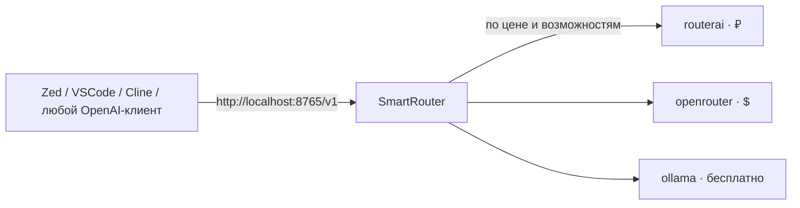

# SmartRouter

**OpenAI-совместимый прокси с умной маршрутизацией моделей.**

Один адрес для всех ваших AI-агентов. Работает с Zed, VSCode (Cline), Cursor,
Continue, OpenWebUI и любым другим клиентом, умеющим говорить с OpenAI API.



---

## Что это даёт

| | Без роутера | Со SmartRouter |
|---|---|---|
| **Модель для агента** | одна на всех | дешёвая для worker'ов, дорогая для координатора |
| **Провайдеры** | прибиты к одному | RouterAI, OpenRouter, локальный Ollama — переключаются без кода |
| **Стоимость** | непрозрачна | посчитана в рублях **и** долларах, с USD-эквивалентом |
| **Каталог моделей** | ручной список | 760 моделей, синхронизируются автоматически |
| **Не-текстовые модели** | в общем списке | отфильтрованы (картинки, видео, TTS, эмбеддинги) |

**Экономия на агентных задачах — до 90%.** Worker-агенту (чтение файлов, тесты,
миграции) хватает модели за ~6 ₽/1M токенов, тогда как «универсальная» модель
может стоить 132 ₽/1M — разница в 22 раза.

---

## Быстрый старт

### 1. Установка

```bash
git clone https://github.com/DinozGit/smart-routing.git
cd smart-routing

python -m venv venv
venv\Scripts\activate            # Windows
# source venv/bin/activate       # macOS / Linux

pip install -r requirements.txt
```

Всего **5 зависимостей**: `fastapi`, `uvicorn`, `httpx`, `python-dotenv`, `pyyaml`.

### 2. Ключи провайдеров

```bash
copy .env.example .env           # Windows
# cp .env.example .env           # macOS / Linux
```

Впишите хотя бы один ключ:

```env
ROUTERAI_KEY=sk-ra-...
OPENROUTER_API_KEY=sk-or-v1-...
```

Локальный Ollama ключа не требует.

> `.env` в `.gitignore` — в репозиторий он не попадёт.

### 3. Запуск

```bash
python router.py
```

Роутер слушает **127.0.0.1:8765** — API и админка на одном порту.
Проверка:

```bash
curl http://localhost:8765/health
# {"status":"ok","cost":"0.0000","currency":"RUB"}
```

### 4. Загрузить каталог моделей

Откройте <http://localhost:8765/admin> → вкладка **Models** → **«Sync всех»**.

Скачается каталог всех провайдеров: **351** RouterAI + **399** OpenRouter +
**10** Ollama = **760** моделей с ценами и валютами.

### 5. Подключить клиент

```bash
curl http://localhost:8765/v1/chat/completions \
  -H "Content-Type: application/json" \
  -d '{"model":"routerai::deepseek/deepseek-v4-flash",
       "messages":[{"role":"user","content":"Привет"}]}'
```

Подробные инструкции для каждого IDE — в **[docs/IDE_SETUP.md](docs/IDE_SETUP.md)**.

---

## Подключение к IDE

### VSCode — Cline / Roo Code

Settings → Cline → API Provider:

| Поле | Значение |
|---|---|
| API Provider | `OpenAI Compatible` |
| Base URL | `http://localhost:8765/v1` |
| API Key | `sk-local` — любой текст, роутер его не проверяет |
| Model ID | `routerai::deepseek/deepseek-v4-flash` |

Работает tool-calling, streaming, всё остальное — стандартный OpenAI API.

### Zed — агентная маршрутизация

```json
{
  "language_models": {
    "openai_compatible": {
      "smart-router": {
        "api_url": "http://localhost:8765/v1",
        "available_models": [
          { "name": "SmartAuto", "display_name": "SmartRouter (Auto)" }
        ]
      }
    }
  }
}
```

В Zed модель выбирается **автоматически** по тегу агента — см. раздел
«Агентная маршрутизация».

### Любой OpenAI-клиент

```python
from openai import OpenAI

client = OpenAI(base_url="http://localhost:8765/v1", api_key="sk-local")
resp = client.chat.completions.create(
    model="openrouter::z-ai/glm-5.3-flash",
    messages=[{"role": "user", "content": "Привет"}],
)
```

---

## Модели: формат `provider::model_id`

Роутер работает с **составными** идентификаторами — с указанием провайдера:

| ID | Провайдер | Цена за 1M токенов | Контекст |
|---|---|---|---|
| `routerai::deepseek/deepseek-v4-flash` | RouterAI | **6.02 / 12.04 ₽** | 1M |
| `routerai::minimax/minimax-m3` | RouterAI | 24.09 / 100.54 ₽ | 1M |
| `routerai::deepseek/deepseek-v4-pro` | RouterAI | 131.95 / 219.92 ₽ | 1M |
| `openrouter::z-ai/glm-5.3-flash` | OpenRouter | 0.03 / 0.09 **$** | 1M |
| `ollama::qwen3:4b` | Ollama | **0 / 0** | 256K |

Список всех моделей:

```bash
curl -s http://localhost:8765/v1/models | python -c "import json,sys; [print(m['id']) for m in json.load(sys.stdin)['data']]"
```

> **Составной ID = точное указание.** Если клиент прислал `provider::model`,
> роутер использует именно эту модель и этого провайдера — без «умной»
> перемаршрутизации и без подстановки ролевых промптов.

---

## Агентная маршрутизация

Для IDE с поддержкой субагентов (Zed, Roo Code) роутер умеет сам выбирать модель
по типу агента.

Три роли:

| Роль | Модель по умолчанию | Для кого |
|---|---|---|
| `coordinator` | `routerai::minimax/minimax-m3` | координатор: декомпозиция, ревью |
| `worker_default` | `routerai::deepseek/deepseek-v4-flash` | backend, тесты, боты, devops |
| `worker_img` | `routerai::qwen/qwen3-coder-next` | frontend, mobile, design |

Выбор роли — по тегу `[AGENT:name]` в сообщении:

```
[AGENT:database] создай миграцию для таблицы users
```

Роутятся агенты `coordinator`, `database`, `tests`, `api`, `services`, `bot`,
`devops` → `worker_default`; `frontend`, `mobile`, `design` → `worker_img`.

Соответствие ролей и моделей настраивается в `routing.json` и меняется
**без перезапуска** роутера.

> Если клиент прислал готовую модель (`provider::model`), маршрутизация **не**
> применяется — выбор пользователя уважается.

---

## Провайдеры

Из коробки: **RouterAI** (цены в ₽), **OpenRouter** (цены в $) и **Ollama**
(локально, бесплатно, без API-ключа).

Любой OpenAI-совместимый провайдер добавляется через админку (вкладка
**Providers**) — нужны `base_url`, `models_endpoint` и имя переменной с ключом.

| Поле | Смысл |
|---|---|
| `requires_api_key` | `false` — запрос уходит без `Authorization` (Ollama) |
| `pricing_mode` | `auto` — валюта определяется по типу цены (строка → USD, число → ₽) |
| `default` | провайдер по умолчанию, fallback для моделей вне каталога |
| `extra_headers` | доп. заголовки (OpenRouter: `HTTP-Referer`, `X-Title`) |
| `verify_ssl` / `ca_bundle` | TLS — для корпоративных CA и self-signed |

Полный формат — в **[docs/PROVIDER_CONTRACT.md](docs/PROVIDER_CONTRACT.md)**.

---

## Стоимость и валюты

Цены хранятся вместе с валютой и обновляются при синхронизации каталога.

```yaml
currency:
  base: RUB          # валюта stats["total_cost"]
  usd_rate: 90.0     # 1 USD = 90 ₽
```

В статистике:

| Поле | Значение |
|---|---|
| `total_cost` | сумма **в базовой валюте** (₽) |
| `by_currency` | суммы **в native-валютах**: `{"RUB": 383.12, "USD": 12.45}` |
| `usd_equivalent` | эквивалент в долларах по `usd_rate` |

```bash
curl -s http://localhost:8765/stats | python -m json.tool
```

---

## API

| Метод | Путь | Описание |
|---|---|---|
| `POST` | `/v1/chat/completions` | Основной прокси (OpenAI-совместимый) |
| `GET` | `/v1/models` | Список моделей (составные ID) |
| `GET` | `/health` | Проверка живости |
| `GET` | `/stats` | Статистика и стоимость |
| `GET` | `/logs?level=INFO&limit=200` | Логи |
| `GET` | `/admin` | Веб-админка |
| `GET`/`POST` | `/config` | Конфигурация ролей и агентов |
| `GET`/`POST`/`DELETE` | `/providers[/{name}]` | Управление провайдерами |
| `GET`/`PUT` | `/roles[/{name}]/tuning` | Параметры и промпты ролей |
| `GET` | `/models/available` | Каталог моделей, сгруппированный по провайдерам |
| `POST` | `/models/sync` | Синхронизация каталога (тело `{"provider": "..."}` — опционально) |

---

## Конфигурация

| Файл | Что хранит | В git? |
|---|---|---|
| `config.yaml` | провайдеры, роли, валюты, ручные override'ы цен | ✅ |
| `routing.json` | роли → модели, агент → роль, промпты | ✅ (runtime-конфиг) |
| `models_cache.json` | кеш каталога моделей | ❌ генерируется |
| `.env` | API-ключи | ❌ |

Ручные override'ы цен нужны только для моделей, которых **нет в каталоге**
(свой прокси, self-hosted) — пример в `config.yaml`.

---

## Возможности и ограничения

| | |
|---|---|
| ✅ | `/v1/chat/completions`, streaming (SSE), function calling (`tools`) |
| ✅ | Каталог моделей по провайдерам с автосинхронизацией |
| ✅ | Учёт стоимости в нескольких валютах |
| ✅ | Веб-админка без сборки (vanilla JS) |
| ❌ | Аутентификация самого роутера — рассчитан на локальный запуск (`127.0.0.1`) |
| ❌ | CORS — не включён намеренно: браузерный клиент сможет управлять локальным роутером |
| ❌ | Rate limiting, JSON-логи, Docker — в планах ([docs/ROADMAP.md](docs/ROADMAP.md)) |

---

## Troubleshooting

| Симптом | Решение |
|---|---|
| `Connection refused` | Роутер не запущен: `python router.py` |
| `502 Missing API key: ROUTERAI_KEY` | Не заполнен `.env`. Проверьте `GET /providers` → `has_api_key` |
| `{"detail":"Invalid JSON body"}` | Windows `curl` отправил тело не в UTF-8 — используйте `--data-binary @file` |
| Модель в ответе не та, что выбрана | Указан `SmartAuto` или голое имя без `provider::` — укажите составной ID |
| В промпте лишний текст про делегирование | Та же причина — используйте `provider::model` |
| Пустой ответ | Вкладка **Logs** в админке — там реальная ошибка провайдера |

---

## Документация

| Документ | О чём |
|---|---|
| [docs/IDE_SETUP.md](docs/IDE_SETUP.md) | Подключение к каждому IDE, пошагово |
| [docs/PROVIDER_CONTRACT.md](docs/PROVIDER_CONTRACT.md) | Контракт: каталог, ключи моделей, валюты, API |
| [docs/ROADMAP.md](docs/ROADMAP.md) | Планы, статус фаз, история спринтов |
| [docs/MULTIPROVIDER_PLAN.md](docs/MULTIPROVIDER_PLAN.md) | Архитектура мультипровайдерного роутера |
| [AGENTS.md](AGENTS.md) | Протокол мультиагентной работы |

---

## Разработка

```bash
venv\Scripts\python.exe -m pytest tests/ -q     # 257 тестов
```

Структура тестов — по фазам, каждая в своей директории `tests/phaseN/`.

Правила делегирования и описание write scope — в [AGENTS.md](AGENTS.md).

---

## Лицензия

[MIT](LICENSE) © 2026 DinozGit
